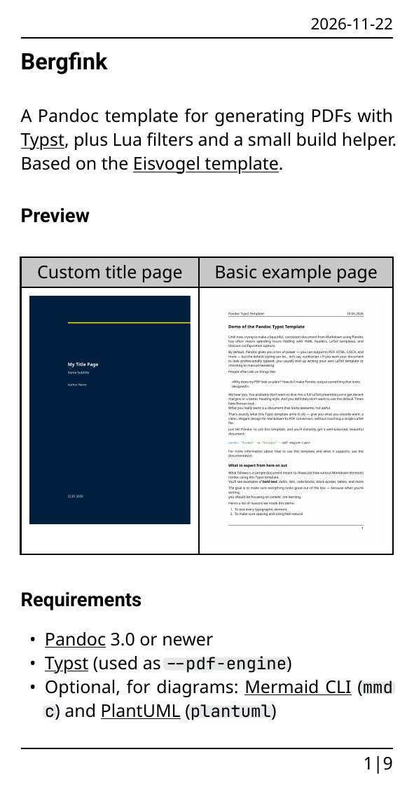

# Fork of Bergfink

This is a fork of Bergfink Pandoc Typst template from @andyburri [https://github.com/andyburri/pandoc-typst-template](https://github.com/andyburri/pandoc-typst-template).

For usage, please check the guide on the original Bergfink github repo _(link above)_.

The modification made in this repo is about allowing user to set custom page size by it's height and width. _(in my case is useful for making pdf that is easy to read on mobile phone screen)_.

The additional `cfg` (config) keys that can be used are:

```typst
// the value are just an example
custom-page: true,
custom-page-height: 190mm,
custom-page-width: 100mm,
custom-page-margin: (x: 0.5cm, top: 1.3cm, bottom: 1.3cm),
custom-header-font-size: 0.9em,
custom-footer-font-size: 1em,
```

# Preview

| Custom Page Size |
| ---------------- |
|  |

_(the complete pdf is in the [examples folder](./examples/full-doc/full-docs-example.pdf))_

# Disclosure of AI Usage

I'm not a developer/code writer. The modification was made with Claude Sonet 5.5 assistance.
